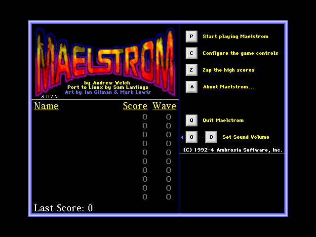
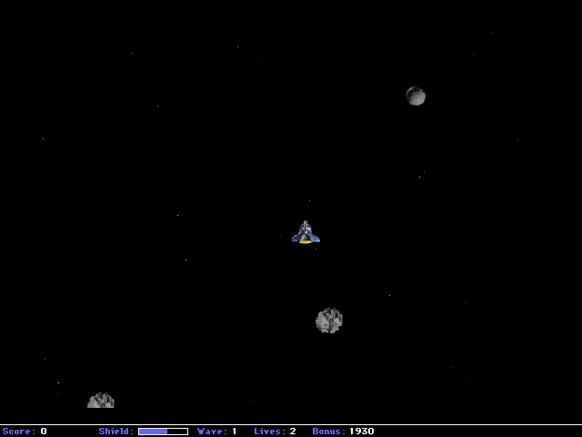
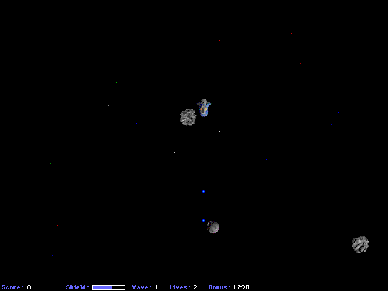

# Maelstrom for the Amiga

Rocks, everywhere. Maelstrom is Ambrosia Software's Asteroids-style
shooter from the Macintosh (Andrew Welch, 1992), freed under the GPL and
ported to SDL by Sam Lantinga: pilot your recon craft through waves of
tumbling asteroids, steel rocks, homing mines, vortexes, novas and the
Shinobi fighters, grab the bonuses (auto-fire, triple shot, long range,
air brakes, multipliers, the Luck of the Irish) and keep your shields for
when it counts.

This is the AmigaOS 3.x port of Maelstrom 3.0.7, on OpenGPU's SDL 2, with
the game's original free graphics, sounds and fonts.

## Controls

In the main menu press a key, or click its key picture:

| Key       | Menu                                        |
|-----------|---------------------------------------------|
| P         | Play                                        |
| L         | Play from a chosen wave                     |
| C         | Change the game keys                        |
| Z         | Clear the high scores                       |
| A         | About Maelstrom                             |
| 0 to 8    | Sound volume                                |
| Q or Esc  | Quit                                        |

In the game (change them with C):

| Key           | Action                     |
|---------------|----------------------------|
| Left / Right  | Turn                       |
| Up            | Thrust                     |
| Tab           | Fire                       |
| Space         | Shield                     |
| P             | Pause                      |
| Esc           | End the game               |
| F3            | Save a screenshot (BMP)    |

A joystick works too: left and right turn, forward thrusts, button 1
fires, button 2 raises the shield.

## Requirements

- AmigaOS 3.x on a 68040 or 68060 with an FPU, and an RTG graphics card
  (a 640x480 window or screen in 16 bit or more).
- OpenGPU 0.6 or later (installed by OpenUp): opengpu.library and
  LIBS:OpenGPU/SDL2.module.
- About 8 MB of free memory and 2.5 MB of disk.

## How to run

Copy the Maelstrom drawer anywhere and double-click **Maelstrom**. Or, from
a Shell:

    cd Maelstrom
    Maelstrom               ; in a window on the Workbench
    Maelstrom -fullscreen   ; on its own 640x480 screen

The high scores and your settings are kept in the game's drawer. See
ReadMe (AMIGA_PORT.md) for what was changed for the Amiga, how to build
it, and the licences. Network play is not in the Amiga version.

## Licence

Maelstrom's code is free software under the GNU GPL, version 2 or later
(COPYING.GPL). Its artwork and animations may be used under Creative
Commons Attribution 3.0 (COPYING.txt); the sounds and fonts come with the
GPL release, free to distribute with the game. Original game (C) 1992-4
Ambrosia Software, Inc.; port to SDL by Sam Lantinga.
